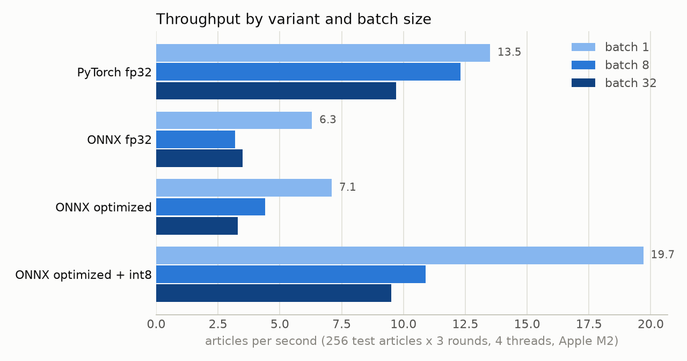
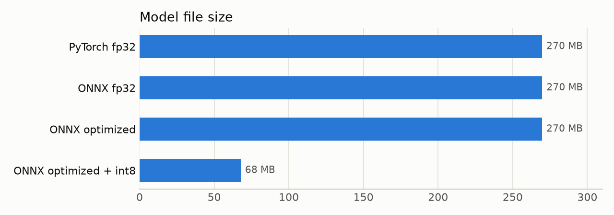
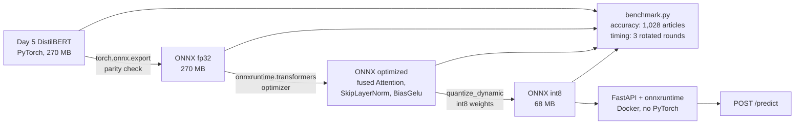

# ONNX Inference Optimization

Takes the fine-tuned German DistilBERT from [german-text-classifier](https://github.com/abhisheklakhani-it/german-text-classifier) (9 news topics, 0.897 macro-F1), exports it to **ONNX**, applies **graph fusion** and **int8 dynamic quantization**, and benchmarks latency, throughput, size and accuracy against PyTorch. The fastest variant is served with **FastAPI** in a **147 MB Docker image without PyTorch**.

[](https://github.com/abhisheklakhani-it/onnx-inference-optimization/actions/workflows/ci.yml)


**Headline (Apple M2, 4 threads, one article per call):** int8 ONNX has **1.46× PyTorch's throughput** (19.7 vs 13.5 articles/s; median 58 vs 80 ms) and **3.1× that of a plain ONNX export**, **4× smaller** (68 vs 270 MB), for **−0.3 points accuracy** (0.895 vs 0.898).

```console
$ curl -X POST localhost:8000/predict -H 'Content-Type: application/json' \
       -d '{"texts": ["Der FC Bayern gewinnt das Spiel mit 3:0.", "Die Inflation im Euroraum steigt weiter."]}'
{"predictions": [{"label": "Sport", "confidence": 0.992}, {"label": "Wirtschaft", "confidence": 0.9809}],
 "model": "model.optimized.int8.onnx", "ms": 20.2}
```

## Results

### Apple M2 (MacBook Air, 8 GB)

Timing: the first 256 test articles, 3 rounds, each variant in its own process with 4 threads. Accuracy: all 1,028 test articles. Raw runs: [`results/benchmark/`](results/benchmark/), summary: [`results/benchmark.json`](results/benchmark.json).

| Variant | Size | p50 / p95, batch 1 | Articles/s, batch 1 (3 rounds) | Articles/s, batch 32 | Accuracy | Macro-F1 | Same label as PyTorch |
|---|---|---|---|---|---|---|---|
| PyTorch fp32 | 270 MB | 80 / 117 ms | 13.5 (12.7–15.2) | 9.7 | 0.898 | 0.897 | 1,028 / 1,028 |
| ONNX fp32 | 270 MB | 165 / 289 ms | 6.3 (5.3–7.0) | 3.5 | 0.898 | 0.897 | 1,028 / 1,028 |
| ONNX optimized (fused) | 270 MB | 156 / 241 ms | 7.1 (6.3–8.1) | 3.3 | 0.898 | 0.897 | 1,028 / 1,028 |
| **ONNX optimized + int8** | **68 MB** | **58 / 85 ms** | **19.7 (17.9–21.0)** | 9.5 | 0.895 | 0.893 | 1,000 / 1,028 |





### Served from Docker

The int8 model behind FastAPI in the Docker image, 100 single-article requests with real test articles ([`results/docker_api.json`](results/docker_api.json)):

| Image size | Median / p95 request (server) | Median request (client, incl. HTTP) | Correct | Container memory |
|---|---|---|---|---|
| 147 MB compressed, 581 MB on disk | 57.5 / 79.4 ms | 59.9 ms | 93 / 100 | 215 MiB |

## What I learned

- **Exporting to ONNX alone made the model slower, not faster.** On the M2, the plain ONNX export runs at half PyTorch's speed. PyTorch on macOS does its matrix maths through Apple's Accelerate library, which uses the M2's matrix unit; ONNX Runtime's own CPU kernels don't. A single DistilBERT-sized matrix multiply (512×768 · 768×3072) runs at 770 GFLOP/s in PyTorch and 283 GFLOP/s in ONNX Runtime. Graph fusion changed little (7.1 vs 6.3 articles/s).
- **int8 is where the speed comes from.** Dynamic quantization stores the weights as 8-bit integers. That makes the file 4× smaller and lets ONNX Runtime use fast integer dot-product instructions, which is enough to beat PyTorch by 46%. The cost: 28 of 1,028 articles change label, and accuracy drops from 0.898 to 0.895.
- **A fanless laptop needs a fair benchmark protocol.** The first benchmark ran the variants one after another, int8 last, about 20 minutes into the run. It measured int8 at 14.7 articles/s, apparently tied with PyTorch. Run alone and cool, int8 did 20.3. The MacBook Air slows down under sustained load, so the final protocol rotates the variant order every round and rests 20 s between runs; int8's slowest round (17.9) is still faster than PyTorch's fastest (15.2).
- **Bigger batches were slower per article.** Every article in a batch is padded to the longest one, often the 512-token limit, so a batch of 32 does far more work than 32 single calls. With German news articles of very different lengths, batch 1 had the best throughput for every variant. Sorting requests by length before batching would fix this.
- **int8 answers depend on the batch.** Dynamic quantization picks the activation scale per batch, so the same article can get a slightly different score next to a different neighbour: int8 accuracy is 0.895 at batch 1 and 0.893 at batch 32. The fp32 variants give identical results at every batch size.
- **Thread count matters as much as the model.** In Docker, letting ONNX Runtime use all 8 M2 cores made the median request 99 ms; pinning it to the 4 performance cores gave 61 ms. The image defaults to `THREADS=4`.

## How it works



| File | What it does |
|---|---|
| `src/onnxopt/classifier.py` | `OnnxClassifier`: tokenizes with `tokenizers`, runs `onnxruntime`, returns label + confidence. No PyTorch |
| `src/onnxopt/export.py` | `torch.onnx.export` with dynamic batch and sequence axes |
| `src/onnxopt/variants.py` | Graph fusion (`optimize`) and int8 dynamic quantization (`quantize_int8`) |
| `src/onnxopt/bench.py` | Times a model over fixed batches; p50, p95, throughput |
| `src/onnxopt/api.py` | FastAPI: `GET /health`, `POST /predict` |
| `src/onnxopt/paths.py`, `data.py` | Where models live; the 10kGNAD test split |
| `scripts/export.py` | Exports the Day 5 model and checks ONNX against PyTorch on 64 articles |
| `scripts/build_variants.py` | Builds the optimized and int8 variants and checks them against fp32 |
| `scripts/benchmark.py` | Accuracy on all test articles, then rotated timing rounds, one process per run |
| `scripts/plot.py` | The two charts above |
| `scripts/make_colab_notebook.py` | Generates the x86 Colab notebook from the project's own source files |
| `Dockerfile` | `python:3.11-slim` + onnxruntime + the int8 model, non-root user, health check |

## Running it

Needs the Day 5 model in `../german-text-classifier/models/distilbert/` (or set `DAY5_MODEL_DIR`).

```bash
python -m venv .venv && source .venv/bin/activate
pip install -r requirements-dev.txt

python scripts/export.py           # models/model.onnx + parity check
python scripts/build_variants.py   # optimized + int8
python scripts/benchmark.py        # about 45 min on an M2 Air
python scripts/plot.py
```

**API, locally or in Docker**

```bash
uvicorn onnxopt.api:app --app-dir src

docker build -t onnx-news-classifier .
docker run -p 8000:8000 onnx-news-classifier             # THREADS=4 by default; set -e THREADS=<fast cores>
```

| Method | Path | Body | Returns |
|---|---|---|---|
| GET | `/health` | – | status and model file |
| POST | `/predict` | `{"texts": ["...", ...]}` (1–32 texts) | one `{label, confidence}` per text, model, ms; 422 for empty or too many texts, 503 if the model file is missing |

**Tests** (15, no downloads: a tiny DistilBERT is built and exported inside the tests)

```bash
pytest
```

## Limitations

- **One machine.** All numbers come from a fanless M2 laptop with other apps open; the rotated rounds reduce, but don't remove, that noise. On the M2, PyTorch gets Apple's Accelerate library; on an x86 server the PyTorch vs ONNX gap will differ. The x86 notebook ([`notebooks/benchmark_x86_colab.ipynb`](notebooks/benchmark_x86_colab.ipynb)) is ready but its results are not in yet.
- **Dynamic quantization only.** Static quantization (with calibration data), int4, or quantization-aware training could be faster or more accurate; they were not tried.
- **The accuracy loss is measured on one test set.** 28 changed labels out of 1,028 is small, but which articles change is not analysed here.
- **Batching is naive.** Requests are not sorted by length, so batching made things slower; a real server would bucket by length or use dynamic batching.
- **The Docker image runs on the same M2** (in Docker's Linux VM), not on a cloud server.

## Next steps

- [ ] Run the x86 Colab notebook and compare it with the M2
- [ ] Length-bucketed batching in the API
- [ ] Static int8 quantization with a calibration set, and a per-article look at the 28 changed labels
- [ ] Deploy the container to a cloud CPU instance and load-test it
